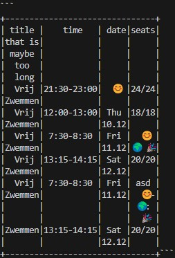

# py-markdown-table
[](https://github.com/hvalev/py-markdown-table/actions/workflows/ci.yml)
[](https://codecov.io/gh/hvalev/py-markdown-table)
[](https://pepy.tech/project/py-markdown-table)
[](https://pepy.tech/project/py-markdown-table)
[](https://pepy.tech/project/py-markdown-table)

Tiny python library with zero dependencies which generates formatted multiline tables in `markdown`. 

## Basic Use
Install via pip as follows: 
```bash
pip install py-markdown-table
```

Pass a `list` of `dict`s where the `dict`s must have uniform keys which serve as column headers and the values are expanded to be rows. Simple example with no special formatting:
```python
from py_markdown_table.markdown_table import markdown_table
data = [
    {
        "Product": "Smartphone",
        "Brand": "Apple",
        "Price": 999.99
    },
    {
        "Product": "Laptop",
        "Brand": "Dell",
        "Price": 1299.99
    }
]
markdown = markdown_table(data).get_markdown()
print(markdown)
```

```
+----------+-----+-------+
|  Product |Brand| Price |
+----------+-----+-------+
|Smartphone|Apple| 999.99|
+----------+-----+-------+
|  Laptop  | Dell|1299.99|
+----------+-----+-------+
```

A more comprehensive example showcasing some of the formatting options:
```python
from py_markdown_table.markdown_table import markdown_table
jokes_list = [
    {
        "joke1": "Why don't scientists trust atoms? Because they make up everything!",
        "joke2": "Did you hear about the mathematician who's afraid of negative numbers? He will stop at nothing to avoid them!",
        "joke3": "Why don't skeletons fight each other? They don't have the guts!"
    },
    {
        "joke1": "What do you call a snowman with a six-pack? An abdominal snowman!",
        "joke2": "Why don't eggs tell jokes? Because they might crack up!",
        "joke3": "How does a penguin build its house? Igloos it together!"
    }
]
markdown = markdown_table(jokes_list).set_params(padding_width = 3, 
                                                 padding_weight = 'centerleft', 
                                                 multiline = {'joke1': 30, 'joke2': 30, 'joke3': 30}
                                                 ).get_markdown()
```
```
+---------------------------------+---------------------------------+---------------------------------+
|              joke1              |              joke2              |              joke3              |
+---------------------------------+---------------------------------+---------------------------------+
|    Why don't scientists trust   |      Did you hear about the     |  Why don't skeletons fight each |
|   atoms? Because they make up   |  mathematician who's afraid of  |    other? They don't have the   |
|           everything!           |  negative numbers? He will stop |              guts!              |
|                                 |    at nothing to avoid them!    |                                 |
+---------------------------------+---------------------------------+---------------------------------+
|    What do you call a snowman   |    Why don't eggs tell jokes?   |   How does a penguin build its  |
|  with a six-pack? An abdominal  |   Because they might crack up!  |    house? Igloos it together!   |
|             snowman!            |                                 |                                 |
+---------------------------------+---------------------------------+---------------------------------+
```

You can also use pandas dataframes by formatting them as follows:
```python
from py_markdown_table.markdown_table import markdown_table
data = df.to_dict(orient='records')
markdown_table(data).get_markdown()
```

## Advanced Use
To add parameters to how the markdown table is formatted, you can use the `set_params()` function on a `markdown_table` object, i.e. `markdown_table(data).set_params(...).get_markdown()`, which allows you to pass the following keyword arguments:

```
+-----------------------+---------------------+-------------------+--------------------------------+
|         param         |         type        |       values      |           description          |
+-----------------------+---------------------+-------------------+--------------------------------+
|        row_sep        |         str         |                   |  Row separation strategy using |
|                       |                     |                   |   `----` as pattern. Possible  |
|                       |                     |                   |           values are:          |
+-----------------------+---------------------+-------------------+--------------------------------+
|                       |                     |       always      |       Separate each row.       |
+-----------------------+---------------------+-------------------+--------------------------------+
|                       |                     |     topbottom     |  Separate the top (header) and |
|                       |                     |                   | bottom (last row) of the table.|
+-----------------------+---------------------+-------------------+--------------------------------+
|                       |                     |      markdown     |  Separate only the header from |
|                       |                     |                   |            the body.           |
+-----------------------+---------------------+-------------------+--------------------------------+
|                       |                     |        None       |    No row separators will be   |
|                       |                     |                   | inserted. Defaults to "always".|
+-----------------------+---------------------+-------------------+--------------------------------+
|     padding_width     |   int or dict[str,  |                   | Extra columns a column gets on |
|                       |         int]        |                   | top of its widest cell. This is|
|                       |                     |                   |  one pool of slack per column, |
|                       |                     |                   |       not one per side -       |
|                       |                     |                   |  `padding_weight` decides how  |
|                       |                     |                   |  the pool is split between the |
|                       |                     |                   | left and the right. Defaults to|
|                       |                     |                   |    `0`. Padding can also be    |
|                       |                     |                   | assigned per column by passing |
|                       |                     |                   | key-value pairs whose keys are |
|                       |                     |                   |   exactly the columns of the   |
|                       |                     |                   |           input data.          |
+-----------------------+---------------------+-------------------+--------------------------------+
|     padding_weight    |   str or dict[str,  |                   |  How the `padding_width` of a  |
|                       |         str]        |                   |  column is distributed between |
|                       |                     |                   |  its left and its right side.  |
|                       |                     |                   |  Can be assigned globally for  |
|                       |                     |                   | the whole table as a string or |
|                       |                     |                   | per-column by passing key-value|
|                       |                     |                   |  pairs whose keys are exactly  |
|                       |                     |                   | the columns of the input data. |
|                       |                     |                   |      Possible values are:      |
+-----------------------+---------------------+-------------------+--------------------------------+
|                       |                     |        left       |  Aligns the cell's contents to |
|                       |                     |                   |      the end of the cell.      |
+-----------------------+---------------------+-------------------+--------------------------------+
|                       |                     |       right       |  Aligns the cell's contents to |
|                       |                     |                   |   the beginning of the cell.   |
+-----------------------+---------------------+-------------------+--------------------------------+
|                       |                     |     centerleft    |  Centers cell's contents with  |
|                       |                     |                   | extra padding allocated to the |
|                       |                     |                   |     beginning of the cell.     |
+-----------------------+---------------------+-------------------+--------------------------------+
|                       |                     |    centerright    |  Centers cell's contents with  |
|                       |                     |                   | extra padding allocated to the |
|                       |                     |                   |        end of the cell.        |
+-----------------------+---------------------+-------------------+--------------------------------+
|      padding_char     |         str         |                   |  Single character used to fill |
|                       |                     |                   |   padding. Default is a blank  |
|                       |                     |                   |           space ` `.           |
+-----------------------+---------------------+-------------------+--------------------------------+
|      newline_char     |         str         |                   | Character appended to each row |
|                       |                     |                   | to force a newline. Default is |
|                       |                     |                   |              ` `.              |
+-----------------------+---------------------+-------------------+--------------------------------+
|     float_rounding    |         int         |                   | Number of digits to keep after |
|                       |                     |                   |  the decimal point of `float`  |
|                       |                     |                   |  cells, rounding them to that  |
|                       |                     |                   |     precision. Must be 0 or    |
|                       |                     |                   |  greater; `None` leaves floats |
|                       |                     |                   |           untouched.           |
+-----------------------+---------------------+-------------------+--------------------------------+
|     emoji_spacing     |         str         |                   |     Strategy for rendering     |
|                       |                     |                   |   characters that a monospace  |
|                       |                     |                   |  font draws two columns wide.  |
+-----------------------+---------------------+-------------------+--------------------------------+
|       multiline       |    dict[str, int]   |                   |    Wrap columns to the given   |
|                       |                     |                   | widths, as a dictionary with a |
|                       |                     |                   | width per column. The width is |
|                       |                     |                   | the space left for content, so |
|                       |                     |                   | `padding_width` is added on top|
|                       |                     |                   |  of it rather than taken from  |
|                       |                     |                   | it. Values must be provided for|
|                       |                     |                   |          every column.         |
+-----------------------+---------------------+-------------------+--------------------------------+
|   multiline_strategy  |         str         |                   |  Strategy applied to rendering |
|                       |                     |                   |   contents in multiple lines.  |
|                       |                     |                   |      Possible values are:      |
+-----------------------+---------------------+-------------------+--------------------------------+
|                       |                     |        rows       |  Splits only rows overfilling  |
|                       |                     |                   |  the predefined column width.  |
+-----------------------+---------------------+-------------------+--------------------------------+
|                       |                     |       header      |     Splits only the header     |
|                       |                     |                   |   overfilling the predefined   |
|                       |                     |                   |          column width.         |
+-----------------------+---------------------+-------------------+--------------------------------+
|                       |                     |  rows_and_header  |     Splits rows and header     |
|                       |                     |                   |   overfilling the predefined   |
|                       |                     |                   |          column width.         |
+-----------------------+---------------------+-------------------+--------------------------------+
|  multiline_delimiter  |         str         |                   | Character a cell's contents are|
|                       |                     |                   |   split on to find places to   |
|                       |                     |                   | wrap, and put back between the |
|                       |                     |                   | parts that end up on one line. |
+-----------------------+---------------------+-------------------+--------------------------------+
|         quote         |         bool        |                   |  Wraps the generated markdown  |
|                       |                     |                   |     table in block quotes `    |
|                       |                     |                   |         ```table``` `.         |
+-----------------------+---------------------+-------------------+--------------------------------+
|        compact        |         bool        |                   | Emit the smallest table that is|
|                       |                     |                   | still valid markdown: cells are|
|                       |                     |                   |    not padded and the header   |
|                       |                     |                   |  separator is a single `-` per |
|                       |                     |                   |  column. Only meaningful when  |
|                       |                     |                   |  the renderer draws the table, |
|                       |                     |                   |    so it requires `row_sep`    |
|                       |                     |                   |   `markdown`. Widths given to  |
|                       |                     |                   | `multiline` are still honoured,|
|                       |                     |                   |     they just no longer add    |
|                       |                     |                   |  padding. Default is `False`.  |
+-----------------------+---------------------+-------------------+--------------------------------+
```
## Type hints
The package ships a `py.typed` marker and every function is annotated, so `mypy` and IDEs see `markdown_table(data).set_params(...)` returning the same type it takes and reject a plain `dict` where a list of rows is expected.

## Utils
The namespace `py_markdown_table.utils` provides `count_emojis()`, `find_longest_contiguous_strings()` and `split_list_by_indices()`. `count_emojis()` reports the characters in a string that a monospace font draws two columns wide - emoji and CJK among them - together with their position, which is what `emoji_spacing` uses. `find_longest_contiguous_strings()` finds the longest string in each column that cannot be broken, which is the width you have to give that column for `multiline` to accept it. `split_list_by_indices()` cuts a string at given offsets and is what the wrapping code uses to treat a wide character as its own break opportunity.

## Further Examples
All the examples below render this data:

```python
data = [
    {"title": "Vrij Zwemmen", "time": "21:30-23:00", "date": "Wed 09.12", "seats": "24/24"},
    {"title": "Vrij Zwemmen", "time": "12:00-13:00", "date": "Thu 10.12", "seats": "18/18"},
    {"title": "Vrij Zwemmen", "time": "7:30-8:30", "date": "Fri 11.12", "seats": "18/18"},
    {"title": "Vrij Zwemmen", "time": "13:15-14:15", "date": "Sat 12.12", "seats": "18/18"},
]
```

## Further Examples
### Row separatation
```python
markdown_table(data).set_params(row_sep = 'always').get_markdown()
```
<details>
    <summary >
    see example
    </summary>

```
+------------+-----------+---------+-----+
|    title   |    time   |   date  |seats|
+------------+-----------+---------+-----+
|Vrij Zwemmen|21:30-23:00|Wed 09.12|24/24|
+------------+-----------+---------+-----+
|Vrij Zwemmen|12:00-13:00|Thu 10.12|18/18|
+------------+-----------+---------+-----+
|Vrij Zwemmen| 7:30-8:30 |Fri 11.12|18/18|
+------------+-----------+---------+-----+
|Vrij Zwemmen|13:15-14:15|Sat 12.12|18/18|
+------------+-----------+---------+-----+
```
</details>
<br/>

```python
markdown_table(data).set_params(row_sep = 'topbottom').get_markdown()
```
<details>
    <summary >
    see example
    </summary>

```
+------------+-----------+---------+-----+
|    title   |    time   |   date  |seats|
|Vrij Zwemmen|21:30-23:00|Wed 09.12|24/24|
|Vrij Zwemmen|12:00-13:00|Thu 10.12|18/18|
|Vrij Zwemmen| 7:30-8:30 |Fri 11.12|18/18|
|Vrij Zwemmen|13:15-14:15|Sat 12.12|18/18|
+------------+-----------+---------+-----+
```
</details>
<br/>

```python
markdown_table(data).set_params(row_sep = 'markdown').get_markdown()
```
<details>
    <summary >
    see example
    </summary>

```
|    title   |    time   |   date  |seats|
|------------|-----------|---------|-----|
|Vrij Zwemmen|21:30-23:00|Wed 09.12|24/24|
|Vrij Zwemmen|12:00-13:00|Thu 10.12|18/18|
|Vrij Zwemmen| 7:30-8:30 |Fri 11.12|18/18|
|Vrij Zwemmen|13:15-14:15|Sat 12.12|18/18|
```
</details>
<br/>


```python
markdown_table(data).set_params(row_sep = 'markdown', quote = False).get_markdown()
```
<details>
    <summary >
    see example
    </summary>

|    title   |    time   |   date  |seats|
|------------|-----------|---------|-----|
|Vrij Zwemmen|21:30-23:00|Wed 09.12|24/24|
|Vrij Zwemmen|12:00-13:00|Thu 10.12|18/18|
|Vrij Zwemmen| 7:30-8:30 |Fri 11.12|18/18|
|Vrij Zwemmen|13:15-14:15|Sat 12.12|18/18|
</details>
<br/>


### Padding, padding weight and padding char
```python
markdown_table(data).set_params(row_sep = 'topbottom', padding_width = 5, padding_weight = 'left').get_markdown()
```
<details>
    <summary >
    see example
    </summary>

```
+-----------------+----------------+--------------+----------+
|            title|            time|          date|     seats|
|     Vrij Zwemmen|     21:30-23:00|     Wed 09.12|     24/24|
|     Vrij Zwemmen|     12:00-13:00|     Thu 10.12|     18/18|
|     Vrij Zwemmen|       7:30-8:30|     Fri 11.12|     18/18|
|     Vrij Zwemmen|     13:15-14:15|     Sat 12.12|     18/18|
+-----------------+----------------+--------------+----------+
```
</details>
<br/>


```python
markdown_table(data).set_params(row_sep = 'topbottom', padding_width = 5, padding_weight = 'centerright').get_markdown()
```
<details>
    <summary >
    see example
    </summary>

```
+-----------------+----------------+--------------+----------+
|      title      |      time      |     date     |  seats   |
|  Vrij Zwemmen   |  21:30-23:00   |  Wed 09.12   |  24/24   |
|  Vrij Zwemmen   |  12:00-13:00   |  Thu 10.12   |  18/18   |
|  Vrij Zwemmen   |   7:30-8:30    |  Fri 11.12   |  18/18   |
|  Vrij Zwemmen   |  13:15-14:15   |  Sat 12.12   |  18/18   |
+-----------------+----------------+--------------+----------+
```
</details>
<br/>


```python
markdown_table(data).set_params(row_sep = 'always', padding_width = 5, padding_weight = 'centerright', padding_char = '.').get_markdown()
```
<details>
    <summary >
    see example
    </summary>

```
+-----------------+----------------+--------------+----------+
|......title......|......time......|.....date.....|..seats...|
+-----------------+----------------+--------------+----------+
|..Vrij Zwemmen...|..21:30-23:00...|..Wed 09.12...|..24/24...|
+-----------------+----------------+--------------+----------+
|..Vrij Zwemmen...|..12:00-13:00...|..Thu 10.12...|..18/18...|
+-----------------+----------------+--------------+----------+
|..Vrij Zwemmen...|...7:30-8:30....|..Fri 11.12...|..18/18...|
+-----------------+----------------+--------------+----------+
|..Vrij Zwemmen...|..13:15-14:15...|..Sat 12.12...|..18/18...|
+-----------------+----------------+--------------+----------+
```
</details>
<br/>

```python
markdown_table(data).set_params(row_sep = 'always', padding_width = 5, padding_weight = 'centerright', padding_char = '.').get_markdown()
```
<details>
    <summary >
    see example
    </summary>

```
+-----------------+----------------+--------------+----------+
|......title......|......time......|.....date.....|..seats...|
+-----------------+----------------+--------------+----------+
|..Vrij Zwemmen...|..21:30-23:00...|..Wed 09.12...|..24/24...|
+-----------------+----------------+--------------+----------+
|..Vrij Zwemmen...|..12:00-13:00...|..Thu 10.12...|..18/18...|
+-----------------+----------------+--------------+----------+
|..Vrij Zwemmen...|...7:30-8:30....|..Fri 11.12...|..18/18...|
+-----------------+----------------+--------------+----------+
|..Vrij Zwemmen...|..13:15-14:15...|..Sat 12.12...|..18/18...|
+-----------------+----------------+--------------+----------+
```
</details>
<br/>

### Per-column padding and padding weight
```python
markdown_table(data).set_params(row_sep = 'always', padding_width = {"title": 2, "time": 4, "date": 3, "seats": 1}, padding_weight = {"title": "left", "time": "right", "date": "centerleft", "seats": "centerright"}).get_markdown()

```
<details>
    <summary >
    see example
    </summary>

```
+--------------+---------------+------------+------+
|         title|time           |    date    |seats |
+--------------+---------------+------------+------+
|  Vrij Zwemmen|21:30-23:00    |  Wed 09.12 |24/24 |
+--------------+---------------+------------+------+
|  Vrij Zwemmen|12:00-13:00    |  Thu 10.12 |18/18 |
+--------------+---------------+------------+------+
|  Vrij Zwemmen|7:30-8:30      |  Fri 11.12 |18/18 |
+--------------+---------------+------------+------+
|  Vrij Zwemmen|13:15-14:15    |  Sat 12.12 |18/18 |
+--------------+---------------+------------+------+
```
</details>
<br/>


The last example sizes three columns, so its per-column dicts line up with its data:

```python
data = [
    {"A": "row1_A and additional stuff", "B": "row1_B", "C": "row1_C"},
    {"A": "row2_A", "B": "row2_B and additional stuff", "C": "row2_C"},
    {"A": "row3_A", "B": "row3_B", "C": "row3_C"},
]
```

```python
markdown_table(data).set_params(row_sep = 'always', padding_width = {"A": 2, "B": 4, "C": 3}, padding_weight = {"A": "left", "B": "right", "C": "centerleft"}).get_markdown()
```
<details>
    <summary >
    see example
    </summary>

```
+-----------------------------+-------------------------------+---------+
|                            A|B                              |    C    |
+-----------------------------+-------------------------------+---------+
|  row1_A and additional stuff|row1_B                         |  row1_C |
+-----------------------------+-------------------------------+---------+
|                       row2_A|row2_B and additional stuff    |  row2_C |
+-----------------------------+-------------------------------+---------+
|                       row3_A|row3_B                         |  row3_C |
+-----------------------------+-------------------------------+---------+
```
</details>
<br/>
### Compact output
When a markdown renderer draws the table, the padding and the long separator are only costing you characters. `compact=True` drops both and leaves the smallest table that is still valid markdown, which matters when the output goes into a field with a size limit. It needs `row_sep="markdown"`, because where the characters themselves form the borders an unpadded table is unreadable.

```python
data = [
    {"_time": "2025-10-03T12:54:42.000+00:00", "field1": "text text", "field2": "aa bb cc"},
    {"_time": "2025-10-04T09:15:00.000+00:00", "field1": "more text", "field2": "dd ee ff"},
]
```

```python
markdown_table(data).set_params(row_sep = "markdown", quote = False, compact = True).get_markdown()
```
<details>
    <summary >
    see example
    </summary>

```
|_time|field1|field2|
|-|-|-|
|2025-10-03T12:54:42.000+00:00|text text|aa bb cc|
|2025-10-04T09:15:00.000+00:00|more text|dd ee ff|
```
</details>
<br/>

### Multiline and emoji
Wrapping needs a width per column, and the first two examples use:

```python
data = [
    {"A": "row1_A and additional stuff", "B": "row1_B", "C": "row1_C"},
    {"A": "row2_A", "B": "row2_B and additional stuff", "C": "row2_C"},
    {"A": "row3_A", "B": "row3_B", "C": "row3_C"},
]
```

```python
markdown_table(data).set_params(padding_width = 0, padding_weight = "centerleft", multiline = {"A": 25, "B": 12, "C": 9}).get_markdown()
```
<details>
    <summary >
    see example
    </summary>

```
+-------------------------+------------+---------+
|            A            |      B     |    C    |
+-------------------------+------------+---------+
|  row1_A and additional  |   row1_B   |  row1_C |
|          stuff          |            |         |
+-------------------------+------------+---------+
|          row2_A         | row2_B and |  row2_C |
|                         | additional |         |
|                         |    stuff   |         |
+-------------------------+------------+---------+
|          row3_A         |   row3_B   |  row3_C |
+-------------------------+------------+---------+
```
</details>
<br/>


```python
markdown_table(data).set_params(padding_width = 2, padding_weight = "centerleft", multiline = {"A": 25, "B": 12, "C": 9}).get_markdown()
```
<details>
    <summary >
    see example
    </summary>

```
+---------------------------+--------------+-----------+
|             A             |       B      |     C     |
+---------------------------+--------------+-----------+
|   row1_A and additional   |    row1_B    |   row1_C  |
|           stuff           |              |           |
+---------------------------+--------------+-----------+
|           row2_A          |  row2_B and  |   row2_C  |
|                           |  additional  |           |
|                           |     stuff    |           |
+---------------------------+--------------+-----------+
|           row3_A          |    row3_B    |   row3_C  |
+---------------------------+--------------+-----------+
```
</details>
<br/>


```python
data = [
    {"those are multi rows": "yes they are"},
    {"those are multi rows": "no they are not"},
]
```

```python
markdown_table(data).set_params(row_sep = "always", multiline = {"those are multi rows": 5}, multiline_strategy = "rows_and_header").get_markdown()
```
<details>
    <summary >
    see example
    </summary>

```
+-----+
|those|
| are |
|multi|
| rows|
+-----+
| yes |
| they|
| are |
+-----+
|  no |
| they|
| are |
| not |
+-----+
```
</details>
<br/>


```python
data = [
    {"title that is maybe too long": "Vrij Zwemmen", "time": "21:30-23:00", "date": "\U0001f60a", "seats": "24/24"},
    {"title that is maybe too long": "Vrij Zwemmen", "time": "12:00-13:00", "date": "Thu 10.12", "seats": "18/18"},
    {"title that is maybe too long": "Vrij Zwemmen", "time": "7:30-8:30", "date": "Fri 11.12", "seats": "\U0001f60a\U0001f30d\U0001f389"},
    {"title that is maybe too long": "Vrij Zwemmen", "time": "13:15-14:15", "date": "Sat 12.12", "seats": "20/20"},
    {"title that is maybe too long": "Vrij Zwemmen", "time": "7:30-8:30", "date": "Fri 11.12", "seats": " asd  \U0001f60a-\U0001f30d:\U0001f389"},
    {"title that is maybe too long": "Zwemmen", "time": "13:15-14:15", "date": "Sat 12.12", "seats": "20/20"},
]
```

```python
markdown_table(data).set_params(row_sep = "topbottom", emoji_spacing = "mono", multiline = {"title that is maybe too long": 7, "time": 11, "date": 5, "seats": 5,}, multiline_strategy = "rows_and_header").get_markdown()
```
<details>
    <summary >
    see example
    </summary>
*Note:* Github's markdown preview does not render emojis as two whole characters, hence the slight offsets in cells containing emojis. 

```
+-------+-----------+-----+-----+
| title |    time   | date|seats|
|that is|           |     |     |
| maybe |           |     |     |
|  too  |           |     |     |
|  long |           |     |     |
|  Vrij |21:30-23:00|  😊 |24/24|
|Zwemmen|           |     |     |
|  Vrij |12:00-13:00| Thu |18/18|
|Zwemmen|           |10.12|     |
|  Vrij | 7:30-8:30 | Fri | 😊🌍|
|Zwemmen|           |11.12|  🎉 |
|  Vrij |13:15-14:15| Sat |20/20|
|Zwemmen|           |12.12|     |
|  Vrij | 7:30-8:30 | Fri | asd |
|Zwemmen|           |11.12| 😊- |
|       |           |     |🌍:🎉|
|Zwemmen|13:15-14:15| Sat |20/20|
|       |           |12.12|     |
+-------+-----------+-----+-----+
```

Below is an example from a monospaced terminal, where the table is rendered correctly.


</details>


## Benchmarks
The table below provide some benchmark results, evaluating the performance on data containing incrementally larger number of `columns`, `rows`, and characters in each table cell (i.e. `cell_size`). You can benchmark it on your own system using the script contained within `utils/benchmark.py`. Generally, reasonably-sized tables intended to be read by a human can be generated within a millisecond. 

<details>
    <summary >
    see benchmark
    </summary>

```
+----------------+-----------+---------------+
|   parameters   | Multiline |     speed     |
+----------------+-----------+---------------+
|   columns: 2   |   False   |  0.191895 ms  |
|    rows: 10    |           |               |
|  cell_size: 5  |           |               |
+----------------+-----------+---------------+
|   columns: 4   |   False   |  0.251465 ms  |
|    rows: 40    |           |               |
|  cell_size: 20 |           |               |
+----------------+-----------+---------------+
|   columns: 8   |   False   |  1.875732 ms  |
|    rows: 160   |           |               |
|  cell_size: 80 |           |               |
+----------------+-----------+---------------+
|   columns: 16  |   False   |  22.107422 ms |
|    rows: 640   |           |               |
| cell_size: 320 |           |               |
+----------------+-----------+---------------+
|   columns: 2   |    True   |  0.149902 ms  |
|    rows: 10    |           |               |
|  cell_size: 5  |           |               |
+----------------+-----------+---------------+
|   columns: 4   |    True   |  0.463379 ms  |
|    rows: 40    |           |               |
|  cell_size: 20 |           |               |
+----------------+-----------+---------------+
|   columns: 8   |    True   |  6.229248 ms  |
|    rows: 160   |           |               |
|  cell_size: 80 |           |               |
+----------------+-----------+---------------+
|   columns: 16  |    True   | 137.902100 ms |
|    rows: 640   |           |               |
| cell_size: 320 |           |               |
+----------------+-----------+---------------+
```
</details>
